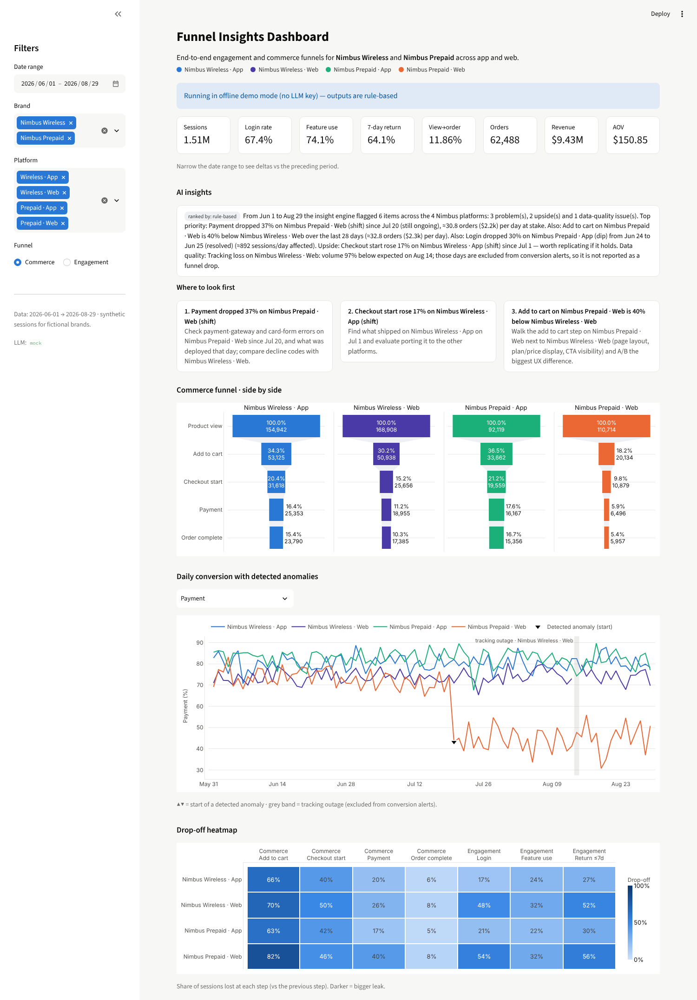
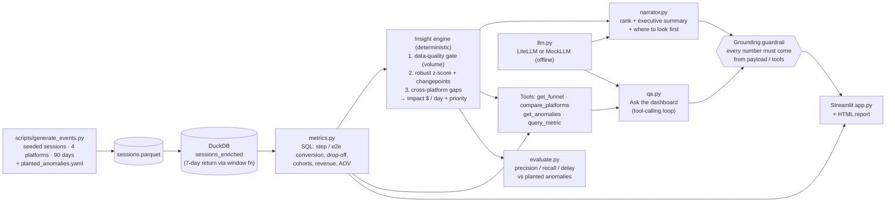

# Funnel Insights Dashboard

**One view of engagement and commerce funnels across 4 digital platforms. A deterministic insight engine finds the drop-offs, and an LLM layer ranks them and explains where to look first.**

   

## Why this matters

When two brands each run an app and a website, every team owns a slice of the funnel and nobody sees the whole thing. A payment bug on one website, a release that lifts checkout on one app, or a tag-manager change that quietly drops tracking can each go unnoticed for weeks. They also get argued about in different dashboards that use different definitions.

This project puts the **Nimbus Wireless** and **Nimbus Prepaid** brands (app and web each) in one place:

- **One view across brands and platforms.** Every funnel step has one SQL definition, and all four platforms are shown side by side in the same colors, so teams compare like with like.
- **Faster detection of drop-offs.** A seasonal robust z-score plus a changepoint detector alert on the first affected day for large changes. The engine also turns each change into orders and revenue at stake per day, so the biggest leak is fixed first.
- **Fewer false alarms from tracking issues.** Volume collapses are classified as *data quality*, not conversion drops, and those days are masked before conversion alerts run. In the evaluation, removing this gate cuts precision from **0.96 to 0.69**.
- **Answers without analyst queues.** "Ask the dashboard" answers questions through tool calls on the metrics layer. The LLM never computes a number itself, and a guardrail checks that every number it quotes appears in a tool result.

## Demo



> `docs/demo.gif`: add your recording here (a short walkthrough of the filters, trend markers and the Ask box).

`make demo` also writes a self-contained HTML report (`reports/funnel_insights_report.html`) with the summary, the ranked insights and all charts.

## Architecture



## Quickstart

Offline demo (no API key and no network after install):

```bash
make setup      # pip install -r requirements.txt   (add --break-system-packages if your Python needs it)
make demo       # generates data on first run, prints top insights + summary, writes reports/*.html
make app        # Streamlit dashboard on http://localhost:8501
```

With a real model (any LiteLLM model string works):

```bash
cp .env.example .env              # or export the variables directly
export ANTHROPIC_API_KEY=sk-...   # LLM_MODEL defaults to anthropic/claude-sonnet-4-5
make demo                         # the LLM now ranks/summarises; token usage + est. cost are printed
```

Other targets: `make test` (offline pytest), `make eval` (detector evaluation), `make data SEED=7` (new dataset), `make screenshot`.
Docker: `docker build -t funnel-insights . && docker run -p 8501:8501 funnel-insights`.

## How it works

**Data.** The data is ~1.5M synthetic sessions over 90 days (Jun 1 – Aug 29, 2026), with one row per session and boolean funnel-step flags:

- *Engagement funnel:* visit → login → feature use (pay bill, view usage, AI-assistant chat) → return within 7 days. Return is computed in SQL with a window function over each user's sessions, and is censored (NULL) when the 7-day follow-up window is incomplete.
- *Commerce funnel:* product view → add to cart → checkout start → payment → order complete, with order values per brand.

The platforms differ in realistic ways: apps log in more and web browses more. The data also includes weekly seasonality, a monthly bill-due bump, user sign-ups and churn, and day-level noise on every rate. Five anomalies are **planted** and written to `data/planted_anomalies.yaml`:

| ID | Platform | What | Start |
|---|---|---|---|
| A1 | Nimbus Prepaid · App | Identity-provider incident: login rate × 0.72 for 2 days | Jun 24 |
| A2 | Nimbus Wireless · App | Release with one-tap checkout: cart → checkout × 1.22 (persistent) | Jul 1 |
| A3 | Nimbus Prepaid · Web | Payment-form bug: checkout → payment × 0.60 (still ongoing) | Jul 20 |
| A4 | Nimbus Prepaid · App | AI-assistant campaign: chat usage × 2.6 for a week | Aug 5 |
| A5 | Nimbus Wireless · Web | Tracking outage: ~97% of sessions untracked, survivors lose events | Aug 14 |

There is also a structural gap: Prepaid web's add-to-cart rate is far below its web peer.

**Insight engine (`detection.py`), fully deterministic.** It runs three detectors in order:

1. **Data-quality gate.** Daily volume is compared with the median of the same weekday over the previous 4 weeks. A drop below 30% is an *outage*, and a drop to 30–60% is a *volume dip*. Those days are masked out of every conversion series. For 7-day return, the 7 days before an outage are masked too.
2. **Anomalies.** These run on 11 daily rate series per platform:
   - a causal **seasonal robust z-score**. The baseline is the same-weekday median. The scale is the largest of three values: the MAD of trailing residuals, binomial noise, and a 3% volatility floor.
   - a persistence rule: lone days need |z| ≥ 5, while runs of 2+ days need |z| ≥ 4.
   - a minimum 5% relative change.
   - known calendar effects. Bill-pay days 1–3 never alert.
   - a **binary-segmentation changepoint** detector on the weekday-adjusted series. It is validated on medians, so a one-week spike is not mistaken for a level shift.

   Overlapping z-runs and changepoints are merged into one insight with the changepoint as its start date.
3. **Cross-platform gaps.** Over the trailing 28 days, a step is flagged when it is ≥ 25% worse than on the like-for-like peer (same channel, other brand) and passes a two-proportion z ≥ 5. A gap explained by an anomaly is linked to it and down-weighted.

Each insight records platform, step/metric, type, direction, shape, magnitude, baseline vs observed, start/end, first-alert date, confidence, and **impact**. Impact is orders and revenue per day for commerce steps, using downstream conversion and AOV, and affected sessions per day for engagement. The priority score is value at stake × confidence × direction (problems before upsides) × recency (ongoing first) × novelty (new regressions before chronic gaps).

**AI layer (`narrator.py`, `qa.py`, `llm.py`).**

- *Briefing.* The model receives the insight JSON, with all numbers precomputed, and returns `{ranking, executive_summary, where_to_look_first}` as JSON. The output is rejected and replaced by the rule-based briefing if any of these hold:
  - the JSON is invalid
  - it references unknown insight IDs
  - it contains a number that is not in the payload
- *Ask the dashboard.* This is a tool-calling loop (at most 5 rounds) over `get_funnel`, `compare_platforms`, `get_anomalies` and `query_metric`. All four run the same SQL as the dashboard. The system prompt forbids arithmetic, and the **grounding guardrail** extracts every number from the answer and checks it against the tool results, allowing only display rounding. Ungrounded numbers are shown as a warning in the UI.
- *Offline mode.* `MockLLM` runs the *same* code paths. Ranking uses the engine's priority score and the narrative is templated. For Q&A, keyword rules pick a tool and template the answer from its result. For questions outside those patterns, it replies plainly that offline mode can't answer.
- *Cost tracking.* With a real model, token usage and estimated cost per run are tracked through LiteLLM and printed by `make demo` and in the report footer.

## Evaluation

`make eval` scores the deterministic engine against the planted ground truth. These are **real measured numbers**; no LLM is involved. Thresholds were tuned on seed 42 (dev). Seeds 1–5 are held out. A detection counts as correct if it is on the same platform, has the right metric and direction, and starts no more than 2 days before the planted start. Delay is first alert minus planted start, in days of a daily batch run, so 0 means the alert fires in the run covering the first affected day.

| Seed | Precision | Recall | False alarms | Delay (days) per planted anomaly | Outage → data_quality | Funnel alerts on outage day (engine vs naive) | Gap P / R |
|---|---|---|---|---|---|---|---|
| 42 (dev) | 1.00 | 1.00 | 0 | A1=0 A2=3 A3=0 A4=0 A5=0 | yes | 0 vs 2 | 1.00 / 1.00 |
| 1 | 0.83 | 1.00 | 1 | A1=0 A2=0 A3=0 A4=0 A5=0 | yes | 0 vs 1 | 1.00 / 1.00 |
| 2 | 1.00 | 1.00 | 0 | A1=0 A2=0 A3=0 A4=0 A5=0 | yes | 0 vs 2 | 1.00 / 1.00 |
| 3 | 1.00 | 1.00 | 0 | A1=0 A2=1 A3=0 A4=0 A5=0 | yes | 0 vs 3 | 1.00 / 1.00 |
| 4 | 1.00 | 1.00 | 0 | A1=0 A2=0 A3=0 A4=0 A5=0 | yes | 0 vs 2 | 1.00 / 1.00 |
| 5 | 1.00 | 1.00 | 0 | A1=0 A2=0 A3=0 A4=0 A5=0 | yes | 0 vs 2 | 1.00 / 1.00 |

**Held-out seeds 1–5:**
- Precision is **0.96** and recall **1.00** (25/25 planted anomalies).
- Mean detection delay is **0.04 days** (max 1).
- The outage is classified as data quality in **5/5** seeds.
- Without the data-quality gate (the naive variant), precision drops to **0.69**, with 11 false alarms instead of 1.
- The single held-out false alarm is a one-day pay-bill spike on seed 1.

**Sensitivity.** The planted effects above are large, so this sweep shrinks the payment bug (A3) to find where detection breaks. It uses seeds 1–3:

| Payment-step drop | Recall | Detection delay (days) |
|---|---|---|
| −5% | 0.00 | — |
| −10% | 1.00 | 19, 21, 9 |
| −15% | 1.00 | 6, 6, 6 |
| −20% | 1.00 | 5, 6, 0 |

A 5% drop on a ~120-checkouts/day step is inside daily noise and is not detected. A 10% drop is caught only by the changepoint detector, after 1–3 weeks.

**LLM quality** (ranking agreement, summary faithfulness, Q&A accuracy) has not been measured. Run `make demo` with your key and review the output, or extend `evaluate.py`, to fill this in. No LLM results are reported here.

## Tech stack

Python 3.11+, DuckDB (SQL metrics layer), pandas / NumPy, Plotly, Streamlit, LiteLLM (Anthropic by default, any provider via `LLM_MODEL`), pytest, Playwright (screenshot), Docker.

## Data source + license

All data is **synthetic**. It is generated by `scripts/generate_events.py` (seeded and reproducible) for two fictional brands, Nimbus Wireless and Nimbus Prepaid. There is no real customer, company or production data. Code is under the MIT License (see `LICENSE`).

## Disclaimer

Personal portfolio project built with public/synthetic data. Not affiliated with any employer.
